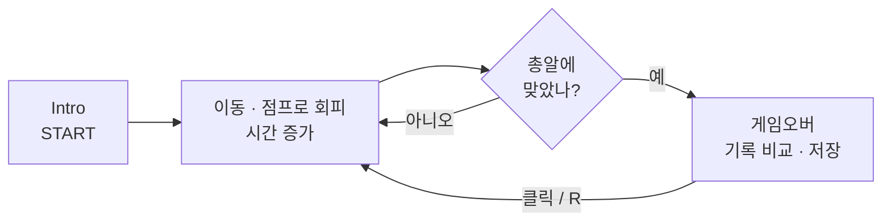

# 01. 게임 컨셉 제안서 — GRAZE

> 문서 세트: [목차](Proposal.md) · **01 컨셉** · [02 시스템](02_System.md) · [03 전투·개체](03_Combat_Entity.md) · [04 레벨 디자인](04_LevelDesign.md) · [05 밸런스](05_Balance.md) · [시뮬레이션](Simulation.html)

---

## 한 줄 정의 (Elevator Pitch)
> **사방의 몬스터가 쏘는 총알을 스치듯 피하며, 1초라도 더 오래 버티는 3D 서바이벌 닷지 게임.**

| 항목 | 내용 |
|---|---|
| 장르 | 3D 탄막 회피(닷지) · 생존 기록 경쟁 |
| 플랫폼 | 모바일 (조이스틱 + 점프 버튼), PC 키보드 테스트 지원 |
| 엔진 | Unity 6 (6000.5.3f1) · C# · Joystick Pack · Cartoon FX Remaster |
| 플레이 시간 | 한 판 30초 ~ 2분 |
| 타깃 유저 | 쉬는 시간에 짧게 즐기는 캐주얼 · 모바일 유저 |
| 이름 뜻 | GRAZE = "살짝 스치다" — 총알을 아슬아슬하게 피하는 순간이 핵심 |

## 핵심 재미 (Core Fun)
| 키워드 | 무엇이 재미있나 | 코드 근거 |
|---|---|---|
| **긴장감** | 4마리가 각자 0.5 ~ 3초 랜덤 간격으로 쏨 → 다음 총알을 예측할 수 없음 | `BulletSpawner` |
| **스릴** | 총알과 플레이어 속도가 같음(8) → 여유 있게 도망칠 수 없고 "옆으로 비켜야" 함 | `Bullet.speed`, `PlayerInput.speed` |
| **공간 활용** | 건물 · 나무 뒤에 숨으면 총알이 막힘 | `Bullet` 충돌 처리 |
| **기록 경쟁** | 버틴 시간이 곧 점수, 최고 기록 저장 | `PlayerPrefs("BestTime")` |

## 코어 루프


| 루프 | 주기 | 현재 | 💡 제안 |
|---|---|---|---|
| 순간 루프 | 0.5 ~ 3초 | 총알 확인 → 피하기 | 아슬아슬하게 피하면 "GRAZE!" 보너스 |
| 세션 루프 | 30초 ~ 2분 | 버티기 → 게임오버 → 즉시 재시작 | 시간에 따라 난이도 상승 (→ 04) |
| 장기 루프 | 여러 판 | 최고 기록 갱신 | 기록 구간별 캐릭터 스킨 해금 |

## 레퍼런스 대비 차별점
| 레퍼런스 (장르) | 가져온 점 | GRAZE의 차이 |
|---|---|---|
| 2D 탄막 슈팅 | 총알을 스치듯 피하는 긴장감 | 평면이 아닌 **3D 맵 + 엄폐물 + 점프** |
| 클래식 닷지 게임 (화면 가장자리에서 날아오는 공) | "맞으면 끝" 단순 규칙 · 생존 시간 점수 | 총알이 **플레이어를 조준**해서 날아옴 → 계속 움직여야 함 |
| 모바일 하이퍼캐주얼 | 한 손 조작 · 즉시 재시작 | 몬스터 공격 애니메이션 · 이펙트로 "보는 맛" 추가 |

## 화면 구성 (와이어프레임)
```
┌───────────────────────────────────────────────┐
│ Time: 37                                       │
│        👾                         👾           │
│                 ▓▓ 건물                         │
│                       🧍 플레이어                │
│        👾       🌳                 👾           │
│  (조이스틱)                          [ 점프 ]   │
│     ◯                                          │
└───────────────────────────────────────────────┘
게임오버 시: 시간 글자 · 점프 버튼 숨김 → "Best Time: 52" + 재시작 안내
```

## 개발 현황
| 구분 | 상태 |
|---|---|
| 구현 완료 | 조이스틱 + 키보드 이동 · 직접 만든 중력 점프 · 벽 막힘 판정 · 발소리 · 몬스터 발사 · 총알 엄폐 · 게임오버 · 최고 기록 · Intro 씬 |
| 에디터 도구 | Intro 씬 자동 생성 · 콜라이더 일괄 변환 · 사운드 자동 연결 (`Assets/Scrips/Editor/`) |
| 다음 목표 | 게임오버 버그 수정 · 발사 예고 · 난이도 곡선 · GRAZE 보너스 |
