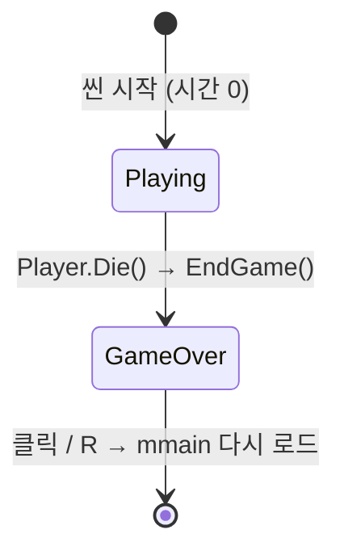
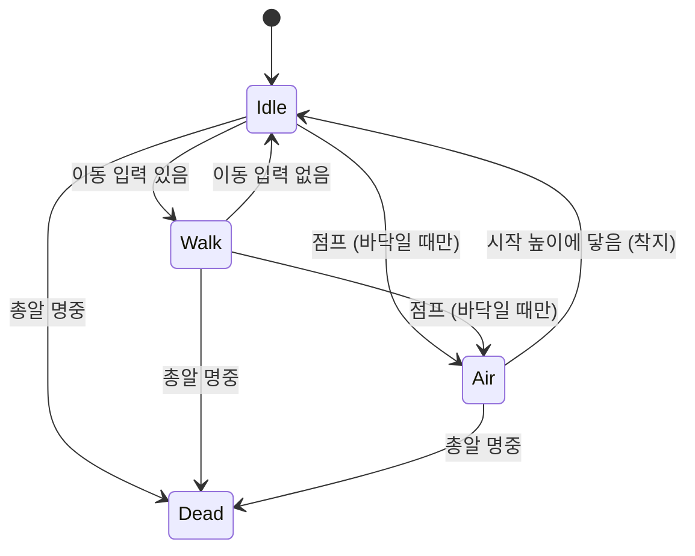

# 02. 시스템 기획서 — 이동 · 회피 · 게임 흐름

> 문서 세트: [목차](Proposal.md) · [01 컨셉](01_Concept.md) · **02 시스템** · [03 전투·개체](03_Combat_Entity.md) · [04 레벨 디자인](04_LevelDesign.md) · [05 밸런스](05_Balance.md)
> 관련 코드: `PlayerInput.cs` · `BulletSpawner.cs` · `Bullet.cs` · `GameManager.cs` · `SceneChange.cs` · `Editor/Graze*.cs`

---

## 1. 화면 흐름도
빌드 씬: `0 Intro` → `1 mmain`


## 2. 상태 머신
**게임 (`GameManager`)**


**플레이어 (`PlayerInput`)**

| 상태 | 애니메이션 | 발소리 | 이동 |
|---|---|---|---|
| Idle | `Walk` false | 끔 | – |
| Walk | `Walk` true | 루프 재생 | 8 m/s |
| Air | `Jump` 트리거 | 끔 | 공중에서도 이동 가능 |
| Dead | – (오브젝트 꺼짐) | – | – |

## 3. 작동 로직
### 3-1. 이동 + 벽 막힘
```
매 프레임
├─ 입력 = 조이스틱 (가로, 세로)
├─ IF 조이스틱 입력 없음 → 키보드 방향키 / WASD 값 사용
├─ IF 입력 있음
│   ├─ 입력 방향을 바라보게 회전
│   ├─ 이번 프레임 이동 거리 = 8 × deltaTime
│   ├─ 벽 검사 IsBlocked(앞, 거리)
│   │   ├─ 발밑에서 0.3m(stepHeight) 띄운 구를 앞으로 SphereCastAll
│   │   ├─ 맞은 것 중 무시: 내 몸 / 이미 겹친 것 / 위를 향한 면이면서 발밑 0.3m 아래인 것(바닥 · 낮은 턱)
│   │   └─ 그 밖의 것이 하나라도 있으면 → 벽 (true)
│   ├─ IF 벽 아님 → 앞으로 이동
│   └─ Walk 애니메이션 켬
└─ ELSE → Walk 애니메이션 끔
발소리: 이동 중 AND 바닥 → 재생 / 그 외 → 정지
```

### 3-2. 점프 (물리 엔진 대신 직접 계산한 중력)
```
점프 입력 (버튼 / Space)
├─ IF 공중 → 무시 (1단 점프만)
└─ ELSE → 위 속도 = 6, Jump 애니메이션, 점프 소리

공중일 때 매 프레임
├─ 위 속도 -= 15 × deltaTime
├─ 높이 += 위 속도 × deltaTime
└─ IF 높이 ≤ 시작 높이 → 시작 높이로 맞추고 착지
```

### 3-3. 몬스터 발사
```
몬스터마다 매 프레임
├─ 경과 시간 += deltaTime
└─ IF 경과 ≥ 이번 발사 간격
    ├─ 경과 0으로
    ├─ 발사 지점에 총알 생성 → 플레이어를 바라보게 (LookAt)
    ├─ 공격 애니메이션
    └─ 다음 발사 간격 = 0.5 ~ 3초 랜덤
```

### 3-4. 총알
```
생성 → 앞으로 속도 8 → 3초 뒤 자동 제거
트리거 충돌
├─ IF 대상 태그 = "PlayerInput"
│   ├─ 맞는 소리 · 이펙트
│   └─ Player.Die() → 플레이어 끔 → GameManager.EndGame() → 배경 음악 재생
└─ ELSE IF 트리거가 아닌 물체 AND 몬스터 자신이 아님 → 이펙트 후 총알 제거 (엄폐)
```

### 3-5. 게임오버 · 기록
```
EndGame()
├─ isGameover = true, 게임오버 창 켬, 시간 글자 · 점프 버튼 숨김
├─ 연결된 몬스터 1마리 발사 끔 + 대기 애니메이션
├─ 최고 기록 = PlayerPrefs("BestTime")
├─ IF 이번 시간 > 최고 기록 → 저장
└─ "Best Time: (정수)" 표시
게임오버 중 매 프레임: IF R키 OR 마우스 클릭 → mmain 다시 로드
```

## 4. 예외 처리 (Edge Case)
> ✅ 처리됨 · ⚠️ 문제 · 💡 제안

| # | 상황 | 현재 동작 | 상태 | 처리 방안 |
|---|---|---|---|---|
| 1 | **게임오버 후 몬스터 발사** | `GameManager`가 몬스터 1마리만 참조 → 씬의 4마리 중 3마리는 계속 쏨 | ⚠️ | 💡 `FindObjectsByType<BulletSpawner>`로 전부 끄기, 또는 게임오버 이벤트를 몬스터가 구독 |
| 2 | 벽 판정 중 이미 벽에 겹쳐 있음 | 거리 0인 충돌 무시 → 빠져나갈 수 있음 | ✅ | – |
| 3 | 낮은 턱 · 바닥 | 0.3m 아래 위쪽 면은 통과 | ✅ | – |
| 4 | **높은 지형 위로 점프** | 착지 높이가 "시작 높이"로 고정 → 위에 올라설 수 없고 허공에서 내려옴 | ⚠️ | 💡 착지를 아래 방향 레이캐스트로 판정 |
| 5 | 공중에서 점프 연타 | 무시 (1단) | ✅ | – |
| 6 | 조이스틱과 키보드 동시 입력 | 조이스틱 우선 | ✅ | – |
| 7 | **게임오버 화면에서 아무 곳이나 클릭** | 즉시 재시작 → 기록 확인 전에 넘어갈 수 있음 | ⚠️ | 💡 게임오버 후 1초 입력 잠금 + "다시 하기" 버튼 |
| 8 | 같은 프레임에 총알 2발 명중 | `Die()`가 두 번 불릴 수 있음 (플레이어가 꺼지기 전) | ⚠️ | 💡 `isDead` 검사로 1번만 처리 |
| 9 | 배경 음악 오브젝트를 이름("Music")으로 찾음 | 이름이 바뀌면 오류 | ⚠️ | 💡 `GameManager`가 참조를 갖고 게임오버 때 재생 |
| 10 | 기록 표시 | 소수점 버림(정수) | 💡 | 0.1초 단위 표시 (기록 경쟁이 핵심이므로) |
| 11 | 일시정지 | 기능 없음 | 💡 | 모바일 백그라운드 전환 시 자동 일시정지 |
| 12 | 총알이 다른 총알에 닿음 | 둘 다 트리거라 무시 | ✅ | – |

## 5. 에디터 자동화 도구
| 도구 | 하는 일 | 효과 |
|---|---|---|
| `GrazeIntroSetup` | Intro 씬(배경 · 제목 · START 버튼) 자동 생성 | 씬을 손으로 다시 만들 필요 없음 |
| `GrazeMapColliders` | 움직이지 않는 오브젝트의 콜라이더를 Mesh Collider로 일괄 변환 | 건물 모양 그대로 총알 · 이동이 막힘 |
| `GrazeSoundSetup` | 플레이어 AudioSource 자동 연결 | 연결 누락 방지 |
