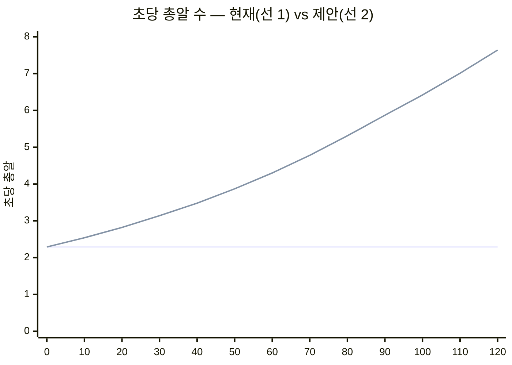

# 04. 레벨 디자인 기획서 — mmain 스테이지

> 문서 세트: [목차](Proposal.md) · [01 컨셉](01_Concept.md) · [02 시스템](02_System.md) · [03 전투·개체](03_Combat_Entity.md) · **04 레벨 디자인** · [05 밸런스](05_Balance.md)
> 데이터: [`05_Balance/difficulty_curve.csv`](05_Balance/difficulty_curve.csv)

---

## 1. 스테이지 콘셉트
| 항목 | 내용 |
|---|---|
| 이름 | 몬스터 광장 (`mmain` 씬) |
| 구조 | 가운데 열린 공간 + 건물 · 나무 엄폐물, 바깥쪽에 몬스터 4마리 |
| 플레이 목표 | 최대한 오래 생존 |
| 동선 의도 | 열린 곳에 오래 있으면 4방향에서 조준당함 → **엄폐물 사이를 옮겨 다니도록** |

## 2. 맵 레이아웃 (탑뷰)
```
   👾 몬스터 1                         👾 몬스터 2
          ┌───┐                ┌──┐
          │ ▓ │ 건물          🌳 │▓▓│
          └───┘                └──┘
                     🧍 시작
          🌳        ┌─────┐        🌳
                    │  ▓  │
   👾 몬스터 3       └─────┘         👾 몬스터 4
```
> 도식이에요. 포트폴리오에는 Unity 씬 뷰 탑다운 캡처를 넣으세요. 맵은 `Rotator`로 천천히 돌아서 매 판 몬스터 각도가 바뀌어요.

| 배치 요소 | 의도 |
|---|---|
| 몬스터 4마리를 바깥에 분산 | 한 방향만 보고 피할 수 없게 |
| 엄폐물 (Mesh Collider) | 총알을 막는 "안전지대" — 단, 숨어 있으면 다른 방향에 노출 |
| 가운데 빈 공간 | 엄폐물 사이 이동 경로 = 위험 구간 |

## 3. 시간대별 난이도 곡선
**현재:** 처음부터 끝까지 같음 (몬스터 4마리, 각 0.5 ~ 3초) → 초당 평균 **2.29발**

**💡 제안:** 10초마다 발사 간격 × 0.9 (최소 0.2초 / 최대 간격 하한 0.8초)

| 구간 | 시간 | 초당 총알 | 설계 의도 | 추가 요소 (💡) |
|---|---|---|---|---|
| 학습 | 0 ~ 20초 | 2.3 → 2.8 | 조작 · 엄폐 익히기 | 발사 예고 0.53초 |
| 긴장 | 20 ~ 60초 | 2.8 → 4.3 | 엄폐물 사이 이동 강요 | 30초: 부채꼴 몬스터 1마리 추가 |
| 위기 | 60 ~ 90초 | 4.3 → 5.9 | 쉴 틈이 거의 없음 | 60초: 회전 몬스터 1마리 추가 |
| 한계 | 90초 ~ | 5.9 → 7.6 | 기록 경쟁 구간 (상위 유저 변별) | – |



## 4. 기믹 · 오브젝트 (💡 제안)
| 기믹 | 등장 | 효과 |
|---|---|---|
| 무너지는 엄폐물 | 60초 | 총알 10발을 맞으면 사라짐 → 한 곳에 오래 숨지 못함 |
| 슬로우 존 | 랜덤 위치 10초 | 안에 들어간 총알 속도 50% → 위기 탈출 수단 |

## 5. 검증 방법
[`Simulation.html`](Simulation.html)에서 "난이도 곡선" 체크를 켜고 끄며 생존 시간을 비교할 수 있어요.
