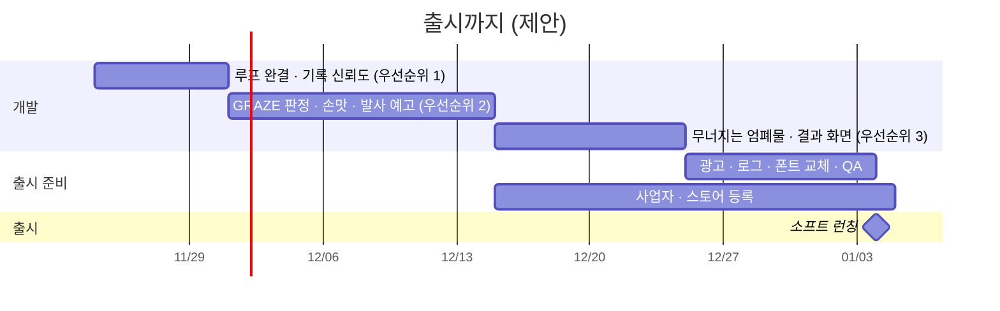

# 사업 검토 — GRAZE

> 문서 세트: [목차](Proposal.md) · 기획: [컨셉](Concept.md) · [시스템](System.md) · [전투·개체](Combat_Entity.md) · [레벨 디자인](LevelDesign.md) · [밸런스](Balance.md) · 사업·운영: **사업 검토** · [요구사항·로드맵](Requirements.md) · [Business Model](Monetization.md) · [서버·데이터](Server_Data.md) · [리소스](Resources.md) · [로그·지표](Analytics.md) · [QA·출시](QA_Release.md) · [라이브 운영](LiveOps.md) · [사업화·법무](Business_Legal.md) · [needFix](needFix.md)

> **문서 정보** · 문서 번호 `D01-BIZ` · 버전 v1.0 · 상태 `Draft` · 담당 대표 · 기획자 · 최종 수정 2026-11-21 · 관련 문서 [컨셉](Concept.md) · [Business Model](Monetization.md) · [사업화·법무](Business_Legal.md)

**변경 이력**

| 버전 | 날짜 | 변경 내용 | 사유 | 결정자 | 영향 범위 |
|---|---|---|---|---|---|
| v1.0 | 2026-11-21 | 최초 작성 | — | 대표 | — |

---

## 1. 목적
이 게임을 **출시까지 만들 가치가 있는지** 판단하는 문서예요. 사업계획서 · 정부지원사업 신청서의 원본으로도 써요. 숫자는 **목표 · 가정**이에요.

## 2. 한 장 요약
| 항목 | 내용 | 상태 |
|---|---|---|
| 게임 이름 | GRAZE ("살짝 스치다") | 확정 (상표 확인 필요) |
| 한 줄 정의 | 사방의 몬스터가 쏘는 총알을 옆으로 비켜 서고 건물 뒤에 숨으며 오래 버티는 3D 탄막 회피 게임 | 확정 ([컨셉](Concept.md)) |
| 최종 방향 | 총알을 스쳐(GRAZE) 콤보 · 점수를 뽑는 **1분 아케이드 스코어 어택** | needFix §7 결정 |
| 장르 | 하이퍼 캐주얼 · 아케이드 | 확정 |
| 플랫폼 | 모바일 (조이스틱 + 점프), PC는 테스트. `Assets/AppsInToss` 폴더가 있지만 SDK 패키지는 없음 | 유통 채널 결정 → [F-01](needFix.md#8-정할-것) |
| 타깃 | 쉬는 시간에 1분 안팎으로 기록 경쟁을 즐기는 모바일 캐주얼 유저 | 확정 |
| 수익 모델 | 광고 (전면 · 보상형) + 광고 제거 → [Business Model](Monetization.md) | 제안 |

## 3. 경쟁작 비교
> 유형으로 적었어요. 실제 게임 3개를 골라 채워 주세요 → [F-02](needFix.md#8-정할-것)

| 유형 | 보통의 Business Model | 이 게임의 차별점 |
|---|---|---|
| 2D 탄막 피하기 캐주얼 | 광고 | **3D 공간 · 건물 엄폐**로 총알을 막음 |
| 탄막 슈팅 (STG) | 프리미엄 · 캐릭터 | 쏘지 않고 **스치는 것**이 점수 |
| 1분 기록 도전 게임 | 광고 · 랭킹 | 날짜로 정하는 "오늘의 탄막" (needFix §7) |

## 4. 목표 지표 (KPI) — 가정
| 지표 | 목표 (예시값) | 확인 방법 |
|---|---|---|
| 한 판 평균 생존 시간 | 30 ~ 45초 (먼저 맞출 구간) | [로그](Analytics.md) `evt_run_end.survive_sec` ([S-17](needFix.md)) |
| 결과 → 다시 하기 비율 | 70% | `evt_retry` ([S-20](needFix.md)) |
| 하루 1인당 판 수 | 10판 | `evt_run_start` |
| D1 재접속률 | 25% | `evt_session_start` |
| 광고 제거 구매율 | DAU의 0.3% | `evt_purchase` |

## 5. 개략 예산 (1인 개발)
| 항목 | 내용 |
|---|---|
| 인건비 | 1인 (기획 · 개발 겸임) |
| 에셋 | 무료 에셋 다수 — **비상업 라이선스 폰트 교체 · 구매 비용** 포함 ([리소스](Resources.md)) |
| 스토어 · 유통 | 채널에 따라 ([F-01](needFix.md)) |
| 서버 | 없음 (최고 기록은 기기) · 주간 랭킹은 보류 |

## 6. 개략 일정
**[타임라인] 출시까지 (제안)**

## 7. 리스크와 대응
| 리스크 | 영향 | 대응 |
|---|---|---|
| **비상업 전용 폰트(Glue Gun)** · 재배포 불가 폰트(arial) 사용 | 상업 출시 시 라이선스 위반 | 출시 전 교체 또는 상업 라이선스 구매 ([F-03](needFix.md)) |
| 화면 밖에서 날아오는 총알 ([S-19](needFix.md)) | "억울한 죽음" 리뷰 | 가장자리 화살표 · 카메라 조정 |
| 게임오버 뒤에도 몬스터 3마리가 계속 발사 ([S-01](needFix.md)) | 결과 화면이 지저분 · 버그로 보임 | 우선순위 1 |
| 1분 게임의 짧은 수명 | D7 낮음 | 오늘의 탄막 · 다음 목표 1줄 (needFix §7) |

## 8. 결정 (Gate P0 → P1)
- [ ] 유통 채널 ([F-01](needFix.md)) · 경쟁작 ([F-02](needFix.md)) · 출시 목표일 ([F-13](needFix.md))
