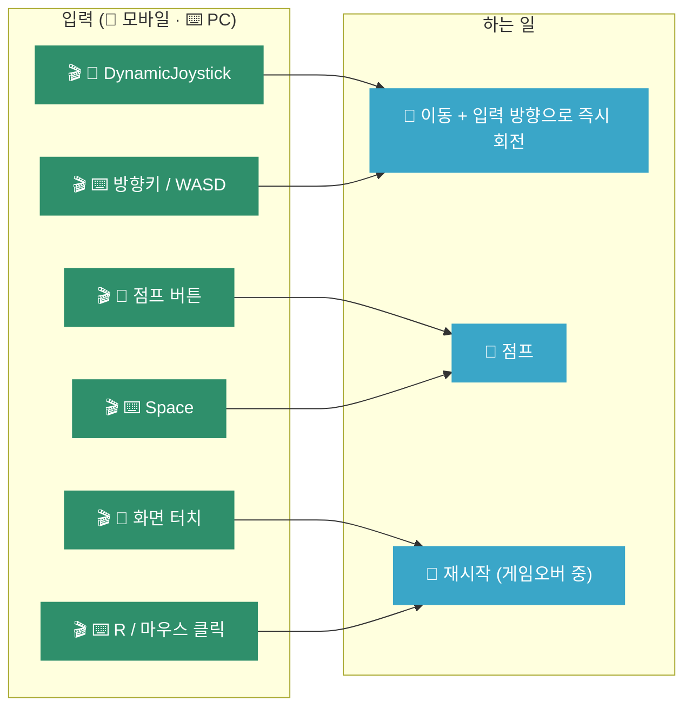
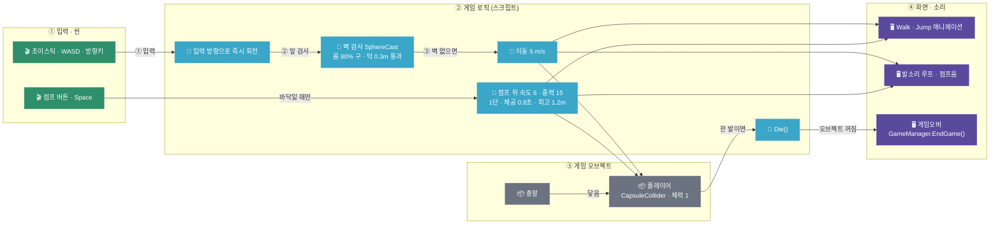
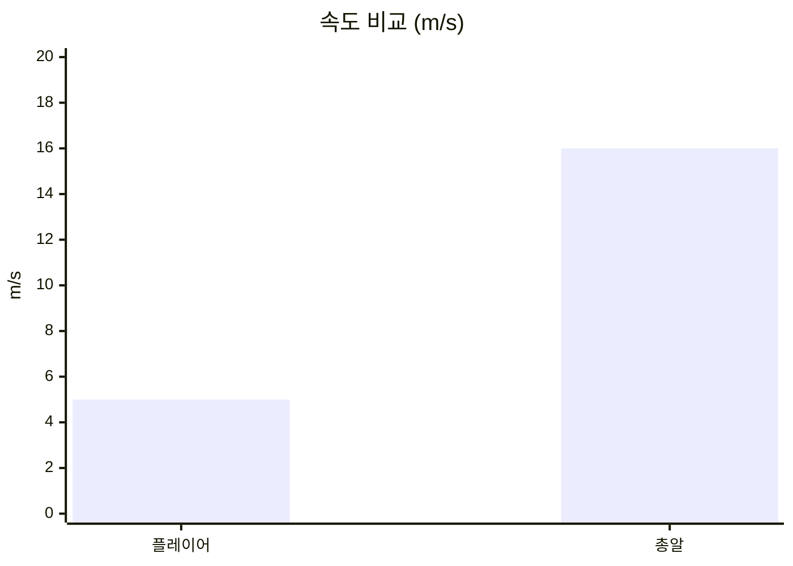
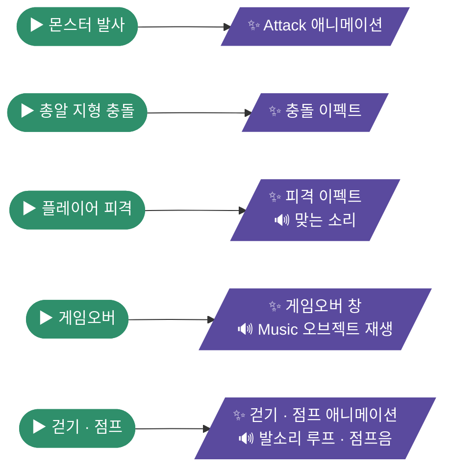

# 전투 · 캐릭터 · 몬스터

> 문서 세트: [목차](Proposal.md) · 기획: [컨셉](Concept.md) · [시스템](System.md) · **전투·개체** · [레벨 디자인](LevelDesign.md) · [밸런스](Balance.md) · 사업·운영: [사업 검토](Business.md) · [요구사항·로드맵](Requirements.md) · [Business Model](Monetization.md) · [서버·데이터](Server_Data.md) · [리소스](Resources.md) · [로그·지표](Analytics.md) · [QA·출시](QA_Release.md) · [라이브 운영](LiveOps.md) · [사업화·법무](Business_Legal.md) · [needFix](needFix.md)
> 모든 값은 `mmain` 씬 · 프리팹에 저장된 실제 값 기준 (코드 기본값과 다르면 함께 표시)

> **문서 정보** · 문서 번호 `D04-ENTITY` · 버전 v1.0 · 상태 `Review` · 담당 기획자 · 아티스트 · 최종 수정 2026-11-21 · 관련 문서 [밸런스](Balance.md) · [리소스](Resources.md)

**변경 이력**

| 버전 | 날짜 | 변경 내용 | 사유 | 결정자 | 영향 범위 |
|---|---|---|---|---|---|
| v0.9 | 2026-11-20 | 기존 문서 (자세한 기록은 git 커밋) | — | 기획자 | — |
| v1.0 | 2026-11-21 | 문서 정보 · 변경 이력 · 문서 번호 추가, 사업 · 운영 문서와 연결 | — | 기획자 | 문서만 |

---

## 1. 조작
| 플랫폼 | 이동 | 점프 | 재시작 |
|---|---|---|---|
| 모바일 | `DynamicJoystick` | 점프 버튼 (`Jump()` 연결) | 화면 터치 (`GetMouseButtonDown(0)`) |
| PC | 방향키 / WASD (`GetAxisRaw`) | Space | R / 마우스 클릭 |

- 입력 방향으로 즉시 회전 (`Quaternion.LookRotation`)

**[구성도] 조작 (입력 → 하는 일)**


## 2. 플레이어 (`PlayerInput`)
**[구성도] 플레이어 (입력 → 처리 → 결과)**


| 항목 | 씬 값 | 코드 기본값 |
|---|---|---|
| 이동 속도 | **5 m/s** | 8 |
| 점프 | 위 속도 6, 중력 15 → 체공 0.8초, 최고 높이 1.2m (1단) | 같음 |
| 벽 판정 | 몸 너비 80% 구 · 여유 0.05m · 턱 0.3m 통과 | 같음 |
| 피격 | 총알 1발 → `Die()` (오브젝트 꺼짐) | – |
| 소리 | 걷는 동안 발소리 루프 · 점프음 | – |

## 3. 몬스터 (`BulletSpawner`)
| 항목 | 값 |
|---|---|
| 수 | 4마리 (`mmain` 씬, 발사 지점 `firePoint` 4개) |
| 쏘는 총알 | `Enemy Variant` 프리팹 (4마리 모두) |
| 발사 간격 | 0.5 ~ 3초 랜덤 (마리마다 따로) |
| 조준 | 생성 순간 플레이어 위치를 `LookAt` (예측 사격 없음) |
| 공격 동작 | 발사와 같은 순간 `Attack` 애니메이션 |
| `fireDelay` | 0.53 — 변수만 있고 코드에서 사용하지 않음 |
| 게임오버 | 연결된 1마리만 발사 끔 + `IdleNormal` |

**[타임라인] 몬스터 1마리의 발사 주기 (간격은 예시)**

```mermaid
gantt
  title 몬스터 발사 주기
  dateFormat x
  axisFormat %S초
  section 몬스터
  대기 (0.5~3초 중 예 2초) :w1, 0, 2000ms
  발사 + 공격 동작 :milestone, f1, 2000, 0ms
  대기 (예 1.5초) :w2, 2000, 1500ms
  발사 + 공격 동작 :milestone, f2, 3500, 0ms
```


## 4. 총알 (`Bullet`)
```
  M  o---------------------------------------------->|
     0m                                             48m
     |<------------- 3s x 16 m/s = 48m -------------->|
```
| 항목 | 값 |
|---|---|
| 속도 | **16 m/s** (`Enemy Variant` 프리팹 · `Bullet.prefab`은 8) |
| 수명 / 사거리 | 3초 (코드 고정값) / 48m |
| 판정 | 트리거 |
| 플레이어 명중 | 맞는 소리 · 이펙트 · 게임오버 |
| 지형 · 건물 명중 | 이펙트 후 제거 (몬스터 자신 · 다른 트리거는 무시) |

**[막대그래프] 속도 비교 (m/s)**


## 5. 맵 회전 (`Rotator`)
| 항목 | 값 |
|---|---|
| 개수 | 씬에 1개 |
| 회전 | Y축, 씬 값 10 (초당 10도) — 코드 기본값 60 |

## 6. 이펙트 · 사운드
**[흐름도] 이펙트 · 사운드 (일이 생기면 → 보이고 들리는 것)**


| 대상 | 이펙트 | 사운드 |
|---|---|---|
| 몬스터 발사 | `Attack` 애니메이션 | – |
| 총알 지형 충돌 | 충돌 이펙트 | – |
| 플레이어 피격 | 피격 이펙트 | 맞는 소리 |
| 게임오버 | 게임오버 창 | "Music" 오브젝트 재생 |
| 걷기 · 점프 | 걷기 · 점프 애니메이션 | 발소리 루프 · 점프음 |
