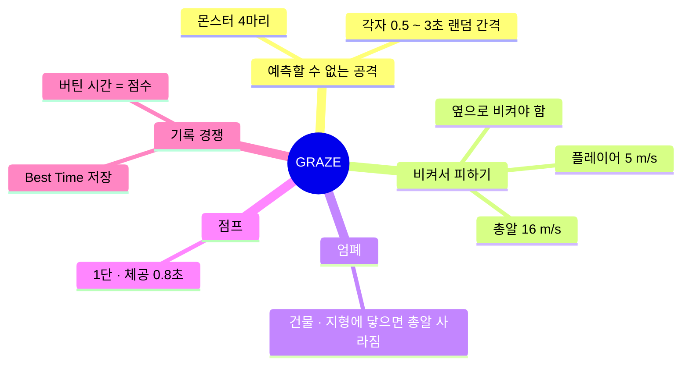
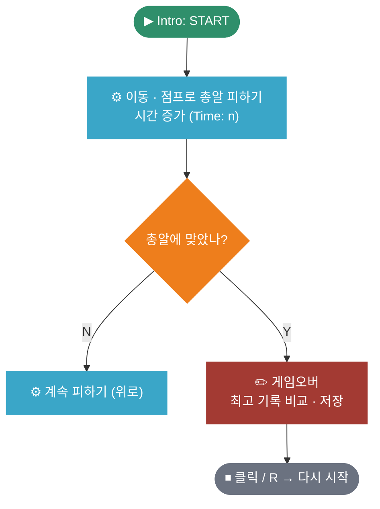

# 게임 컨셉 — GRAZE

> 문서 세트: [목차](Proposal.md) · 기획: **컨셉** · [시스템](System.md) · [전투·개체](Combat_Entity.md) · [레벨 디자인](LevelDesign.md) · [밸런스](Balance.md) · 사업·운영: [사업 검토](Business.md) · [요구사항·로드맵](Requirements.md) · [Business Model](Monetization.md) · [서버·데이터](Server_Data.md) · [리소스](Resources.md) · [로그·지표](Analytics.md) · [QA·출시](QA_Release.md) · [라이브 운영](LiveOps.md) · [사업화·법무](Business_Legal.md) · [needFix](needFix.md)

> **문서 정보** · 문서 번호 `D01-CONCEPT` · 버전 v1.0 · 상태 `Review` · 담당 기획자 · 최종 수정 2026-11-21 · 관련 문서 [사업 검토](Business.md) · [요구사항·로드맵](Requirements.md)

**변경 이력**

| 버전 | 날짜 | 변경 내용 | 사유 | 결정자 | 영향 범위 |
|---|---|---|---|---|---|
| v0.9 | 2026-11-20 | 기존 문서 (자세한 기록은 git 커밋) | — | 기획자 | — |
| v1.0 | 2026-11-21 | 문서 정보 · 변경 이력 · 문서 번호 추가, 사업 · 운영 문서와 연결 | — | 기획자 | 문서만 |

---

## 기획 의도
> 기획자가 정한 방향이에요. 아래 "개요"부터는 지금 코드 · 씬에 구현된 내용이에요.

| 항목 | 내용 |
|---|---|
| 한 줄 정의 | 사방의 몬스터가 쏘는 총알을 옆으로 비켜 서고 건물 뒤에 숨으며 오래 버티는 3D 탄막 회피 게임 |
| 기획 의도 (핵심 재미) | 총알이 플레이어보다 3.2배 빨라 달려서는 못 도망친다 → "언제 옆으로 비켜 설지, 어디에 숨을지"를 순간적으로 판단하는 긴장감 |
| 타깃 | 쉬는 시간에 1분 안팎으로 기록 경쟁을 즐기는 모바일 캐주얼 유저 |
| 플랫폼 · 제약 | 모바일(조이스틱 + 점프 버튼), PC는 테스트용 |
| 레퍼런스 · 차별점 | 탄막 슈팅의 회피 감각 + 짧은 기록 경쟁 캐주얼 → 2D가 아닌 **3D 공간에서 건물로 총알을 막는 엄폐** |

## 개요
| 항목 | 내용 | 근거 |
|---|---|---|
| 장르 | 3D 탄막 회피(닷지) · 생존 시간 기록 | `GameManager` (생존 시간 · 최고 기록) |
| 플랫폼 | 모바일 조이스틱 + 점프 버튼, PC 키보드 | `PlayerInput` (`DynamicJoystick`, 방향키 · WASD · Space) |
| 엔진 | Unity 6 (6000.5.3f1) · C# | `ProjectSettings` |
| 사용 에셋 | Joystick Pack, Cartoon FX Remaster | `Assets/` |
| 씬 | `Intro` → `mmain` | 빌드 설정 |
| 이름 | GRAZE = "살짝 스치다" | `README.md` |

## 재미 요소 (코드에서 확인되는 것)
| 요소 | 내용 | 코드 근거 |
|---|---|---|
| 예측할 수 없는 공격 | 몬스터 4마리가 각자 0.5 ~ 3초 랜덤 간격으로 발사 | `BulletSpawner.spawnRateMin/Max`, 씬 몬스터 4마리 |
| 비켜서 피하기 | 총알 속도 16 > 플레이어 속도 5 → 달려서 도망칠 수 없고 옆으로 비켜야 함 | `Enemy Variant` 프리팹 `Bullet.speed`, 씬 `PlayerInput.speed` |
| 엄폐 | 총알이 건물 · 지형에 닿으면 사라짐 | `Bullet.OnTriggerEnter` |
| 점프 | 1단 점프 (체공 0.8초) | `PlayerInput.Jump` |
| 기록 경쟁 | 버틴 시간 = 점수, 최고 기록 저장 | `PlayerPrefs("BestTime")` |

```
(위에서 본 모습)
   M ----------------------> X     X = 발사 순간의 플레이어 위치 (LookAt)
                             P --> 플레이어가 이미 옆으로 움직였으면 빗나감

   M ======> o ======> ####        #### = 건물 · 지형: 총알이 닿으면 사라짐 (엄폐)
```

**[마인드맵] 재미 요소 한눈에**


## 코어 루프

**[흐름도] 코어 루프**


## 화면에 있는 요소
위치는 씬에서 확인하세요. 아래는 코드 · 씬에 있는 요소 목록이에요.

**Intro**  (GrazeIntroSetup가 만듦)
 - background
 - title
 - START button

**mmain**
 - TimeText "Time: n"
 - DynamicJoystick
 - Jump button
 - monsters x4 · map

**Game Over**
 - gameOverUI
 - RecordText "Best Time: n"
 - RestartText
 - TimeText · Jump button 숨김

## 개발 현황
| 구분 | 내용 |
|---|---|
| 구현됨 | 조이스틱 + 키보드 이동, 직접 계산한 중력 점프, 벽 막힘 판정, 발소리, 몬스터 발사, 총알 엄폐, 게임오버, 최고 기록, Intro 씬, 맵 회전 |
| 에디터 도구 | Intro 씬 자동 생성 · 콜라이더 일괄 변환 · 사운드 자동 연결 (`Assets/Scrips/Editor/`) |
| 다음 할 일 | [needFix](needFix.md) |
