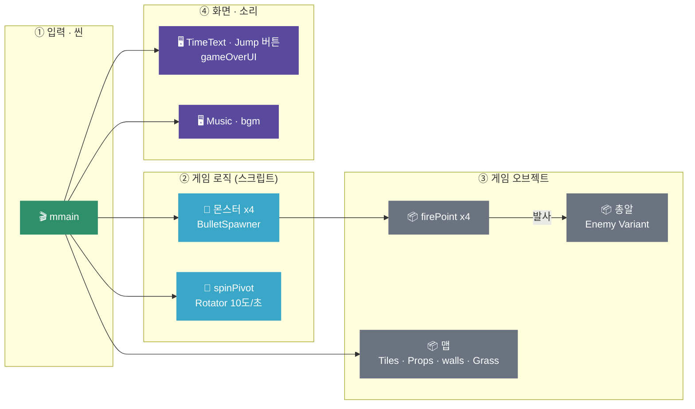

# 레벨 디자인 — mmain 씬

> 문서 세트: [목차](common_Index.md) · 기획: [컨셉](planner_Concept.md) · [시스템](planner_System.md) · [전투·개체](planner_Combat_Entity.md) · **레벨 디자인** · [밸런스](planner_Balance.md) · 사업·운영: [사업 검토](owner_Business.md) · [요구사항·로드맵](planner_Requirements.md) · [Business Model](planner_Monetization.md) · [서버·데이터](developer_Server_Data.md) · [리소스](designer_Resources.md) · [로그·지표](planner_Analytics.md) · [QA·출시](tester_Release.md) · [라이브 운영](operator_LiveOps.md) · [사업화·법무](owner_Legal.md) · [needFix](common_needFix.md)

> **문서 정보**

| 문서 번호 | 버전 | 상태 | 책임자 | 협업 | 최종 수정 | 관련 문서 |
|---|---|---|---|---|---|---|
| `D05-LEVEL` | v1.1 | `Review` | 레벨 디자이너 | 밸런스 기획자 | 2026-11-23 | [밸런스](planner_Balance.md) |

**변경 이력**

| 버전 | 날짜 | 변경 내용 | 사유 | 결정자 | 영향 범위 |
|---|---|---|---|---|---|

---

## 1. 씬 구성
| 항목 | 내용 | 근거 |
|---|---|---|
| 씬 | `mmain` (플레이), `Intro` (시작 화면) | 빌드 설정 |
| 몬스터 | 4마리 (`BulletSpawner` 4개, `firePoint` 4개) | 씬 |
| 지형 · 장식 | `Tiles`, `Props`, `walls`, `Grass Pack`, `Grass and Edge Details` | 씬 오브젝트 이름 |
| 엄폐물 | 건물 · 나무 등 움직이지 않는 오브젝트 → Mesh Collider (`GrazeMapColliders`) | 에디터 도구 |
| 회전 | `spinPivot` + `Rotator` 1개 (초당 10도) | 씬 |
| 목표 | 최대한 오래 생존 | `GameManager` |

> 맵의 실제 배치(몬스터 · 건물 위치)는 씬 탑다운 캡처 첨부 필요 (담당: 레벨 디자이너) → [S-14](common_needFix.md)

**[구성도] mmain 씬 구성**


**[도면] mmain 씬 — 몬스터 · 플레이어 시작 위치 (위에서 본 모습)**
```
z 31.9
  ........................................................
  ...........................N............................
  ........................................................
  ........................................................
  ........................................................
  ........................................................
  ........................................................
  ........................................................
  ........................+...............................
  .....W...........................P................E.....
  ........................................................
  ........................................................
  ........................................................
  ........................................................
  ........................................................
  ........................................................
  ...........................S............................
  ........................................................
z -1.7   x -11.1 ~ 18.1  (오른쪽 = +x, 위 = +z)
```

| 표시 | 무엇 | 씬 이름 | 월드 좌표 (x, z) |
|---|---|---|---|
| N | 몬스터 (북) | `EnemyBox` | 3.3, 29.1 |
| S | 몬스터 (남) | `EnemyBox (1)` | 3.3, 1.1 |
| E | 몬스터 (동) | `EnemyBox (2)` | 15.7, 14.6 |
| W | 몬스터 (서) | `EnemyBox (3)` | -8.7, 14.6 |
| P | 플레이어 시작 | `Player` | 6.3, 14.5 |
| + | 맵 회전 중심 (초당 10도) | `spinPivot` | 1.8, 15.2 |

몬스터 4마리가 플레이어를 둘러싼 십자 모양임. 맵 전체(`spinPivot` 아래)가 회전하므로 위치는 시작 순간 기준임. 건물 배치는 씬 캡처가 필요함 ([S-14](common_needFix.md)).

## 2. 난이도
현재는 처음부터 끝까지 같은 조건임.

| 시간 | 몬스터 | 발사 간격 | 초당 총알 (평균) |
|---|---|---|---|
| 0초 ~ 게임오버 | 4마리 | 0.5 ~ 3초 랜덤 | 2.29발 |

> 시간에 따라 어려워지는 곡선은 [S-09](common_needFix.md)
