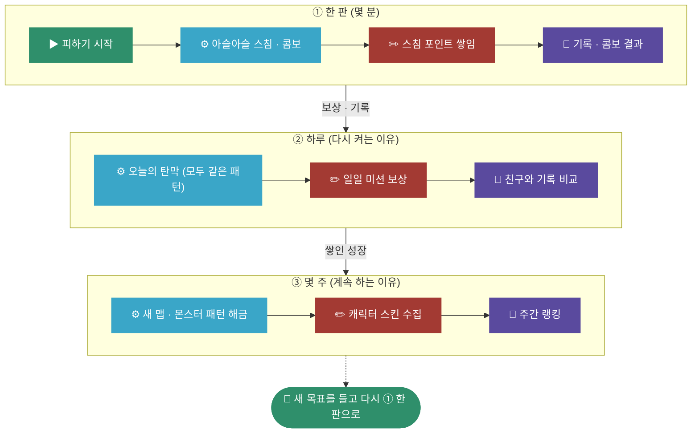

# needFix — 고칠 점 · 부족한 점 · 제안

> 문서 세트: [목차](Proposal.md) · 기획: [컨셉](Concept.md) · [시스템](System.md) · [전투·개체](Combat_Entity.md) · [레벨 디자인](LevelDesign.md) · [밸런스](Balance.md) · 사업·운영: [사업 검토](Business.md) · [요구사항·로드맵](Requirements.md) · [Business Model](Monetization.md) · [서버·데이터](Server_Data.md) · [리소스](Resources.md) · [로그·지표](Analytics.md) · [QA·출시](QA_Release.md) · [라이브 운영](LiveOps.md) · [사업화·법무](Business_Legal.md) · **needFix**
> 컨셉 ~ 밸런스 문서는 현재 구현만 담고, 바꾸자는 내용은 모두 여기에 모았어요. 반영하면 상태를 **완료**로 바꾸고 컨셉 ~ 밸런스 문서의 값을 고쳐 주세요. 사업 · 운영 문서(계획 · 초안)에서 나온 **정할 것**은 8절에 있어요.

> **문서 정보** · 문서 번호 `D00-FIX` · 버전 v1.0 · 상태 `Review` · 담당 기획자 · 최종 수정 2026-11-21

**변경 이력**

| 버전 | 날짜 | 변경 내용 | 사유 | 결정자 | 영향 범위 |
|---|---|---|---|---|---|
| v0.9 | 2026-11-20 | 기존 문서 (자세한 기록은 git 커밋) | — | 기획자 | — |
| v1.0 | 2026-11-21 | 문서 정보 · 변경 이력 · 문서 번호 추가, 사업 · 운영 문서와 연결, Suggestions에서 이름 변경 | — | 기획자 | 문서만 |

---

## 1. 버그 · 코드와 의도가 다른 부분
| ID | 현재 (코드 근거) | 문제 | 제안 | 관련 | 상태 |
|---|---|---|---|---|---|
| S-01 | `GameManager.bulletSpawner` 1개만 끔 (씬 몬스터 4마리) | 게임오버 뒤에도 3마리가 계속 발사 | `FindObjectsByType<BulletSpawner>`로 전부 끄기, 또는 게임오버 이벤트를 몬스터가 구독 | 시스템 §3-5 | 대기 |
| S-02 | `BulletSpawner.fireDelay = 0.53` 선언만 있고 사용 안 함 | 발사 예고가 없음 | 아래 S-10 발사 예고 | 전투·개체 §3 | 대기 |
| S-03 | 착지 높이 = 시작 높이(`groundY`) 고정 | 높은 지형에 올라설 수 없음 | 아래 방향 레이캐스트로 착지 판정 | 시스템 §3-2 | 대기 |
| S-04 | 게임오버 중 아무 클릭이나 즉시 재시작 | 기록 확인 전에 넘어갈 수 있음 | 1초 입력 잠금 + "다시 하기" 버튼 | 시스템 §3-5 | 대기 |
| S-05 | `Die()`에 중복 검사 없음 | 같은 프레임 2발 명중 시 2번 처리 | `isDead` 검사 | 시스템 §4 #8 | 대기 |
| S-06 | `GameObject.Find("Music")` | 이름이 바뀌면 오류 | `GameManager`가 참조를 갖고 재생 | 시스템 §3-4 | 대기 |
| S-07 | 기록을 정수로 표시 (`(int)`) | 기록 경쟁인데 소수점이 버려짐 | 0.1초 단위 표시 | 시스템 §3-5 | 대기 |
| S-08 | 일시정지 · 백그라운드 처리 없음 | 모바일에서 앱 전환 시 계속 진행 | 백그라운드 전환 시 자동 일시정지 | 시스템 §4 | 대기 |

## 2. 부족한 기능 · 밸런스 제안
### S-09 시간에 따른 난이도 곡선

현재는 처음부터 끝까지 초당 2.29발로 같음 (밸런스 §2).

```
k(t)        = 0.9 ^ (t ÷ 10)          10초마다 10% 빨라짐
최소 간격(t) = max(0.2, 0.5 × k)
최대 간격(t) = max(0.8, 3.0 × k)
초당 총알(t) = 4 ÷ ((최소 + 최대) ÷ 2)
```
| 시간 | 0초 | 30초 | 60초 | 90초 | 120초 |
|---|---|---|---|---|---|
| 평균 간격 | 1.75 | 1.28 | 0.93 | 0.68 | 0.52 |
| 초당 총알 | 2.29 | 3.14 | 4.30 | 5.87 | 7.64 |

| 구간 | 시간 | 의도 |
|---|---|---|
| 학습 | 0 ~ 20초 | 조작 · 엄폐 익히기 |
| 긴장 | 20 ~ 60초 | 엄폐물 사이 이동 |
| 위기 | 60 ~ 90초 | 쉴 틈이 거의 없음 |
| 한계 | 90초 ~ | 기록 경쟁 |

### S-10 발사 예고 (S-02 해결안)

**[타임라인] 발사 예고: 현재 vs 제안 (대기 시간은 예시)**

```mermaid
gantt
  title 발사 예고
  dateFormat x
  axisFormat %S.%L초
  section 현재
  대기 (예 2초) :n1, 0, 2000ms
  발사 :milestone, n2, 2000, 0ms
  section 제안
  대기 (예 2초) :p1, 0, 2000ms
  예고 0.53초 (빨갛게 깜빡임) :crit, p2, 2000, 530ms
  발사 :milestone, p3, 2530, 0ms
  후딜 0.2초 :p4, 2530, 200ms
```

> 읽는 법: 제안에서는 발사 전에 0.53초 예고가 생겨 플레이어가 보고 피할 수 있어요. 왼쪽 → 오른쪽이 시간이에요. 막대 = 이어지는 동안, 마름모 = 그 순간. 빨간 막대는 위험하거나 못 움직이는 시간이에요.

### S-11 GRAZE 판정 · 점수 (이름과 재미 연결)
```
   M ==== o ====>
                \
             .---\---.
            /     \   \       점선 원 = GRAZE 판정 범위 (반경은 플레이 테스트로 정하기)
           |   P   >-- o ===> 원 안을 지나가고 몸에는 안 닿음 = GRAZE!
            \         /
             '-------'
```
| 항목 | 제안 |
|---|---|
| 판정 | 총알이 플레이어 주변 일정 거리 안을 지나가고 맞지 않음 (시뮬레이션은 0.6m로 테스트) |
| 보너스 | GRAZE 1회 = 생존 시간 +0.5초 |
| 최종 점수 | 생존 시간 + GRAZE × 0.5 |

### S-12 몬스터 패턴 추가
```
(1) 부채꼴 3발 (15도 간격)      (2) 원형 8발 (45도 간격)
        M                            \  |  /
      / | \                        --   M   --
     v  v  v                         /  |  \
```

### S-13 맵 기믹
| 기믹 | 효과 |
|---|---|
| 무너지는 엄폐물 | 총알 일정 수를 맞으면 사라짐 → 한 곳에 오래 숨지 못함 |
| 슬로우 존 | 안에 들어온 총알 속도 감소 → 위기 탈출 수단 |

## 3. 확인 · 결정이 필요한 항목
| ID | 내용 | 필요한 것 |
|---|---|---|
| S-14 | 맵 배치(몬스터 · 건물 위치)가 문서에 없음 | `mmain` 씬 탑다운 캡처를 레벨 디자인에 추가 |
| S-15 | 한 줄 소개 · 타깃 유저 · 레퍼런스 게임 | 기획자가 정해서 컨셉에 추가 (README의 "한 줄 소개: 직접 작성" 칸) |
| S-16 | 총알 한 발을 항상 피할 수 있는가 | 플레이어 · 총알 콜라이더 크기 확인 + 플레이 테스트 (반응 시간 포함) |
| S-17 | 한 판 평균 생존 시간 | 플레이 테스트로 측정 → S-09 곡선 기준점으로 사용 |

---

## 4. 실무에서 쓸 때 아쉬운 점
위 1 ~ 3절은 게임 내용, 이 절은 **문서를 실무 팀(개발 · 아트 · QA · 사업)과 함께 쓸 때** 부족한 점이에요. **상태** 칸은 반영 여부예요.

| 아쉬운 점 | 왜 문제인가 | 제안 | 상태 |
|---|---|---|---|
| 문서 정보 · 변경 이력이 없음 | 팀원마다 다른 버전을 보고 이야기하게 됨 | 문서 맨 위에 작성자 · 버전 · 날짜 · 변경 내용 표 | ✅ 반영 — 모든 문서 맨 위 문서 정보 · 변경 이력 |
| 기획 의도(왜)가 없음 | 구현 설명서로 읽혀서, 수치를 바꿀 때 판단 기준이 없음 | 각 시스템 첫머리에 "의도 1 ~ 2줄 → 규칙 → 예외" 순서 | ✅ 반영 — [컨셉](Concept.md) 기획 의도 (시스템 첫머리 의도는 문서마다 다시 확인) |
| UI 와이어프레임 · 맵 도면이 없음 | UI · 아트 · 레벨 담당이 위치와 크기를 알 수 없음 | Figma 와이어프레임, 씬 탑다운 캡처에 번호 표시 | ✅ 반영 — 시스템 · 레벨 문서의 [와이어프레임] · [도면] |
| 리소스 목록(ID)이 없음 | 아트 · 사운드 발주와 진행 확인이 어려움 | `FX_` · `SFX_` · `UI_` ID와 담당 · 상태가 있는 표 | ✅ 반영 — [리소스](Resources.md) (라이선스 확인은 F-03) |
| 예외 처리가 테스트 케이스로 이어지지 않음 | QA가 같은 내용을 다시 정리해야 함 | 예외 처리 표에 "확인 방법 · 기대 결과" 칸 추가 → 그대로 QA 체크리스트 | ✅ 반영 — [QA · 출시](QA_Release.md) §3 테스트 케이스 |
| 확인 · 결정 항목에 담당 · 기한이 없음 | 누가 언제 정하는지 몰라 계속 "대기" | 3절 표에 담당 · 기한 칸 추가 | ✅ 반영 — 8절 표에 담당 · 기한 칸 |
| 데이터 원본 형식 (예전 지적: CSV만 있음) | 기획 문서와 엔진이 다른 값을 볼 수 있음 | **JSON을 원본**으로 (결정됨), 검증 규칙(JSON Schema)으로 범위 검사 | ✅ JSON 전환 완료 · 검증 규칙은 F-04 |
| 성공 기준(KPI)이 없음 | 고친 뒤 좋아졌는지 판단할 숫자가 없음 | 한 판 평균 시간 · 재시작률 · D1 / D7 재접속률 목표를 먼저 정하기 | ✅ 반영 — [사업 검토](Business.md) §4 · [로그](Analytics.md) (목표값은 가정) |
| 용어가 섞여 있음 (몬스터 = `BulletSpawner`, 플레이어 = `PlayerInput` 태그) | 기획 · 코드 · 아트가 서로 다른 이름으로 부름 | 문서 앞에 용어집 (기획 이름 ↔ 코드 이름) | 🔶 일부 — 사업 · 운영 문서는 "몬스터 · 플레이어"로 통일, 코드 이름 정리는 F-14 |

## 5. 기획 · 흐름 평가와 방향

**잘된 점**

- 규칙이 한 줄로 설명돼요: "총알이 3.2배 빨라서 달리지 말고 옆으로 비켜라" (밸런스 §3).
- 건물이 총알을 막아 **공간을 쓰는 판단**이 생겨요.
- 조작이 이동 + 점프뿐이라 모바일에 바로 맞아요.

**아쉬운 점** (근거 = 이 문서 세트의 수치)

| 아쉬운 점 | 근거 | 플레이어가 느끼는 것 |
|---|---|---|
| 처음부터 끝까지 난이도가 같음 | 초당 2.29발 고정 (밸런스 §2) | 30초가 지나면 긴장이 더 오르지 않음 |
| 숨는 것이 가장 좋은 전략 | 엄폐물이 사라지지 않음, 점수 = 버틴 시간만 | 건물 뒤에 서 있기만 하는 판이 나옴 |
| 게임 이름(GRAZE = 스치기)이 시스템에 없음 | 스침 판정 · 점수 없음 (S-11) | "아슬아슬하게 피했다"는 쾌감이 보상받지 못함 |
| 점프의 쓰임이 약함 | 총알이 수평으로 날아오고 높은 지형에 못 올라섬 (S-03) | 버튼이 있는데 쓸 이유가 적음 |

**한 판 흐름 평가**

- Intro → 플레이 → 게임오버까지 짧고 끊김이 없어요.
- 게임오버 화면에서 아무 곳이나 누르면 바로 재시작해서(S-04) **기록 갱신을 확인하는 순간**이 없어요. 결과 화면(이번 기록 · 최고 기록 · 다음 목표)이 필요해요.
- 판과 판 사이에 바뀌는 것이 없어서, 다음 판을 할 이유가 "기록"뿐이에요.

**방향 제시** — 우선순위 순서

| 순서 | 방향 | 관련 제안 |
|---|---|---|
| 1 | 게임 정체성을 "스치면 이득"으로: 스침 점수 · 콤보 | S-11 |
| 2 | 시간에 따라 발사 간격이 줄어드는 곡선 | S-09 · S-10 |
| 3 | 엄폐에 제한 두기 (무너지는 엄폐물) | S-13 |
| 4 | 결과 화면 · 재시작 확인 | S-04 |

## 6. 계속 플레이하게 만드는 성장 설계 (제안)
지금은 "최고 생존 시간" 하나만 남아요. 한 판의 스침 점수를 **쌓이는 재화**로 바꾸면 판이 끝나도 남는 것이 생겨요.

**[구성도] 재방문 루프 (제안)**

> 읽는 법: 위 ① 한 판에서 얻은 보상 · 기록이 ② 하루 목표로, ② 하루 목표가 ③ 몇 주짜리 성장으로 이어지고, 맨 아래처럼 새 목표를 들고 다시 ① 한 판으로 돌아와요. 칸 안은 왼쪽 → 오른쪽 순서예요. 초록 = 시작, 파랑 = 하는 일, 빨강 = 쌓이는 값, 보라 = 보이는 보상이에요.

| 단계 | 장치 | 플레이어에게 주는 이유 | 만드는 데 필요한 것 |
|---|---|---|---|
| ① 한 판 | 스침 콤보 · 기록 갱신 연출 | 피하는 순간마다 보상 | S-11 판정 · 결과 화면 |
| ② 하루 | 오늘의 탄막 (고정 시드), 일일 미션 ("스침 50회") | 매일 새 도전 · 모두 같은 조건이라 비교 가능 | 랜덤 시드 고정 · 미션 표 |
| ③ 몇 주 | 생존 60초 달성 시 새 맵 · 패턴 해금, 스침 포인트로 스킨 | 목표가 끝나지 않음 · 수집 | S-12 · S-13 · 상점 UI |
| ③ 몇 주 | 주간 랭킹 (최고 생존 시간) | 경쟁 · 다시 올 이유 | 서버 또는 리더보드 서비스 |

**확인할 숫자 (KPI)**

- 한 판 평균 생존 시간 (S-17) → 30 ~ 60초 목표
- 게임오버 후 재시작률 → 높을수록 "한 판 더"가 작동
- D1 · D7 재접속률 → 일일 탄막 도입 전후 비교

## 7. 최종 방향 · 실행 계획
> 위 1 ~ 6절을 바탕으로, 이 게임이 가장 잘될 방향과 무엇부터 할지 정리한 최종 계획이에요.

**최종 방향**
건물을 방패 · 길목으로 쓰며 총알을 **스쳐 지나가(GRAZE) 콤보와 점수를 뽑는 1분 아케이드 스코어 어택**.
엄폐물은 "영원히 안전한 곳"이 아니라 숨 고르고 각을 만드는 장치예요. 이름(GRAZE) · 타깃(1분 캐주얼) · 재미가 한 방향으로 맞물려요.

**정리된 결정**

| 항목 | 위 절의 내용 | 최종 결정 | 이유 |
|---|---|---|---|
| S-11 GRAZE 점수 | 스침 1회 = 생존 시간 +0.5초 | **생존 시간은 순수 기록**으로 두고, GRAZE는 별도 점수 (예: 100점 × 콤보) | 시간에 더하면 "실제로 몇 초 버텼나"가 흐려지고, 랭킹 · 해금 조건이 꼬여요 |
| S-09 난이도 곡선 | 120초까지 수치 표 | 수치는 **검증 전 가설**로 두고 S-17(평균 생존 시간) 측정 후 조정. 타깃이 1분 안팎이라 **30 ~ 45초 구간**을 먼저 맞추기 | 기준점(플레이 테스트) 없이 정한 수치는 근거가 약해요 |
| S-12 · S-13 범위 | 패턴 2종 + 기믹 2종 | **무너지는 엄폐물 1개만 먼저**, 슬로우 존 · 새 패턴은 보류 | 재미가 "비켜 서기 / 엄폐 / 슬로우 존"으로 흩어지지 않게, 1인 개발 범위에 맞게 |
| 6절 리텐션 | 주간 랭킹(서버) · 상점 · 스킨 · 몇 주 성장 | **로컬 최고 기록 + "다음 판 목표 1줄" + 날짜로 정하는 오늘의 탄막**만 | 1분 캐주얼은 "한 판 더"(세션 안 재시작)가 핵심이고, 서버 · 상점은 만드는 비용 대비 효과가 낮아요 |

**추가 제안**

| ID | 내용 | 근거 |
|---|---|---|
| S-18 | 손맛 피드백: 스칠 때 진동 · 효과음 · 이펙트, 맞을 때 판정을 살짝 너그럽게 (히트박스를 몸보다 조금 작게) | 0.1초 단위로 피하는 게임은 체감 설계가 핵심 |
| S-19 | 화면 끝 몬스터 표시: 화면 밖 몬스터 방향을 가장자리 화살표로, 또는 카메라를 더 높게 · 더 수직으로 | 씬 값: 카메라 높이 23.4m · 아래로 66° · 세로 시야 60° → 북쪽 몬스터(z 29.1)는 화면 위 끝, 남쪽(z 1.1)은 아래 끝에 걸리고 맵이 초당 10도 회전해 가장자리를 들락날락함 → 보이지 않는 곳에서 날아오는 피격이 생길 수 있음 |
| S-20 | 1초 안에 다시 하기: 결과 화면에 이번 기록 · 최고 기록 · 다음 목표까지 남은 시간을 1초 안에 보여 주고, 한 번 누르면 재시작 | 결과 확인 → 재도전 동선이 길면 캐주얼 기록 게임은 이탈해요 (S-04 확장) |

**실행 우선순위** (1인 개발 · 짧은 기간)

| 순서 | 할 일 | 관련 제안 |
|---|---|---|
| 1 | 플레이 루프 완결 · 기록 신뢰도 (게임 기본기 · QA 필수) | S-01 · S-04 · S-05 · S-07 · S-08 |
| 2 | GRAZE 판정 · 손맛 피드백 + 발사 예고 + 초 · 중반 완만한 난이도 상승 | S-11(점수 분리) · S-18 · S-02 / S-10 · S-09 |
| 3 | 무너지는 엄폐물 + 결과 화면 | S-13(일부) · S-20 · S-19 |

## 8. 정할 것
> 정하면 상태를 **완료**로 바꾸고 관련 문서의 `Draft`를 `Review`로 올려 주세요.

| ID | 내용 | 왜 필요한가 | 관련 문서 | 담당 | 기한 | 상태 |
|---|---|---|---|---|---|---|
| F-01 | 유통 채널 확정 (스토어 / 앱인토스 — `Assets/AppsInToss` 폴더만 있고 SDK 없음) | 광고 SDK · 빌드 종류가 채널마다 다름 | [사업 검토](Business.md) | 대표 · 기획자 | 알파 전 | 대기 |
| F-02 | 경쟁작 3개 선정 · 장단점 정리 | 차별점 근거 | [사업 검토](Business.md) §3 | 대표 · 기획자 | 알파 전 | 대기 |
| F-03 | **Glue Gun 폰트(비상업 전용) · arial.ttf 교체 또는 상업 라이선스**, GSHYEJAROUN · 카카오톡 이미지 출처 확인 | 광고만 넣어도 상업 이용 → 출시 차단 사유 | [리소스](Resources.md) §2 · [사업화 · 법무](Business_Legal.md) | 아티스트 · 대표 | 베타 전 | ⚠️ 대기 |
| F-04 | 랭킹을 만들면 어떤 방식으로 (스토어 리더보드 · 서버) | 기록 위조 방지 · 비용 | [서버 · 데이터](Server_Data.md) §3 | 개발자 | 출시 후 검토 | 대기 |
| F-05 | 기록 저장 키 이름 정리 (`BestTime` → `GRAZE_BestTime`) · 저장 시점 | 다른 키와 섞임 방지 · 앱 종료 시 유실 방지 | [서버 · 데이터](Server_Data.md) §4 | 개발자 | 알파 | 대기 |
| F-06 | 전면 광고 빈도 (5판마다) · 광고 제거 가격 확정 | 1분 게임은 광고 시간 비율이 커짐 | [Business Model](Monetization.md) | 기획자 · 대표 | 베타 전 | 대기 |
| F-07 | 중복 · 안 쓰는 에셋 정리 (`Clips` ↔ `Sounds`, 29곡 BGM 중 쓰는 것만) | 빌드 용량 · 라이선스 점검 범위 | [리소스](Resources.md) | 개발자 | 베타 | 대기 |
| F-08 | 분석 도구 선택 | [REQ_113](Requirements.md) 시작 조건 | [로그 · 지표](Analytics.md) | 기획자 · 개발자 | 베타 전 | 대기 |
| F-09 | 목표 FPS · 동시 최대 총알 · 기준 기기 | 회피 게임은 프레임 = 공정성 | [QA · 출시](QA_Release.md) §4 | QA · 개발자 | 알파 | 대기 |
| F-10 | JSON 검증 규칙(JSON Schema) — `Balance/schema/*.schema.json` | 범위를 벗어난 값을 빌드 전에 잡기 | [밸런스](Balance.md) | 개발자 | 베타 전 | 대기 |
| F-11 | 타깃 연령 | 광고 정책 · 개인정보 표기 | [사업화 · 법무](Business_Legal.md) | 기획자 · 대표 | 출시 준비 전 | 대기 |
| F-12 | 사업자 형태 · 등록 시점 (다른 게임 · 서비스와 같은 사업자로 갈지) | 스토어 조직 계정 · 정산 | [사업화 · 법무](Business_Legal.md) | 대표 | 출시 준비 전 | 대기 |
| F-13 | 출시 목표일 | 일정 기준 | [사업 검토](Business.md) §6 | 대표 · 기획자 | 알파 후 | 대기 |
| F-14 | 용어집 — 코드 이름(`BulletSpawner` = 몬스터, `PlayerInput` 태그 = 플레이어)과 문서 용어 맞추기 | 문서 · 코드 · 로그 이벤트 이름이 엇갈림 | 모든 문서 | 대표 · 기획자 | 베타 | 대기 |
