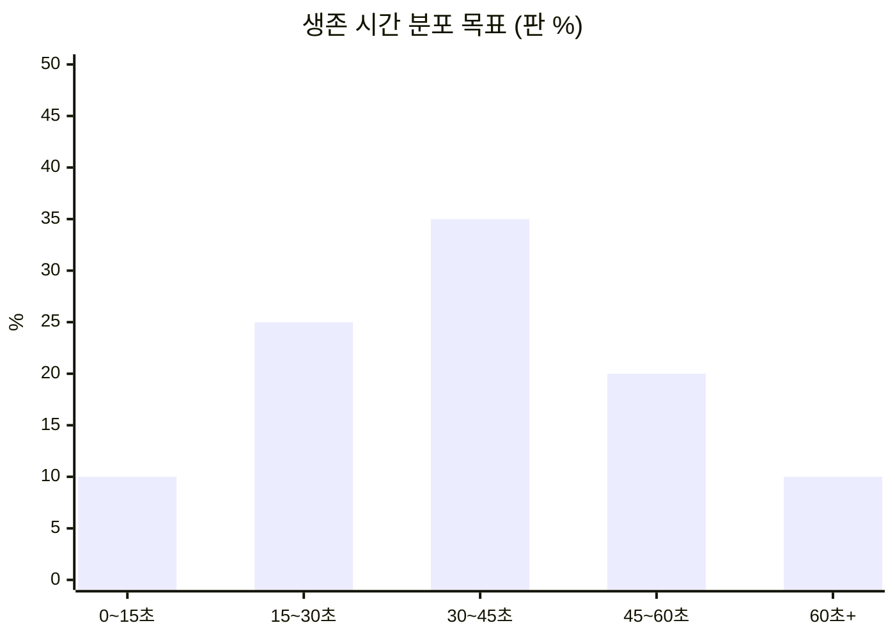

# 로그 · 지표 설계 — GRAZE

> 문서 세트: [목차](common_Index.md) · 기획: [컨셉](planning_Concept.md) · [시스템](planning_System.md) · [전투·개체](planning_Combat_Entity.md) · [레벨 디자인](planning_LevelDesign.md) · [밸런스](planning_Balance.md) · 사업·운영: [사업 검토](owner_Business.md) · [요구사항·로드맵](planning_Requirements.md) · [Business Model](planning_Monetization.md) · [서버·데이터](dev_Server_Data.md) · [리소스](design_Resources.md) · **로그·지표** · [QA·출시](qa_QA_Release.md) · [라이브 운영](ops_LiveOps.md) · [사업화·법무](owner_Business_Legal.md) · [needFix](common_needFix.md)

> **문서 정보** · 문서 번호 `D10-LOG` · 버전 v1.0 · 상태 `Draft` · 담당 기획자 · 클라이언트 개발자 · 최종 수정 2026-11-21 · 관련 문서 [사업 검토](owner_Business.md) · [Business Model](planning_Monetization.md)

**변경 이력**

| 버전 | 날짜 | 변경 내용 | 사유 | 결정자 | 영향 범위 |
|---|---|---|---|---|---|
| v1.0 | 2026-11-21 | 최초 작성 | — | 기획자 | — |

---

## 1. 목적
출시 후 **무엇을 측정할지** 정하는 문서예요.
> 지금 구현: 로그 없음, 분석 패키지 없음. 도구 선택 → [F-08](common_needFix.md#8-정할-것)

## 2. 이름 규칙
- 이벤트 `evt_대상_동작`, 파라미터 `snake_case`, 공통 `app_version` · `platform` · `session_id`
- 개인정보는 넣지 않아요.

## 3. 이벤트 목록
| 이벤트 | 발생 시점 | 파라미터 | 확인할 지표 |
|---|---|---|---|
| `evt_session_start` | `Intro` 시작 | first_open | DAU · D1 |
| `evt_run_start` | `mmain` 시작 · 재시작 | run_index, daily(bool) | 하루 판 수 |
| `evt_run_end` | 사망 | survive_sec, graze_count, max_combo, score, death_dir(앞 / 뒤 / 옆 / 화면 밖), jumps | 평균 생존 ([S-17](common_needFix.md)) · 화면 밖 피격 비율 ([S-19](common_needFix.md)) |
| `evt_retry` | 결과 화면에서 다시 하기 | wait_sec(결과 화면에 머문 시간) | 다시 하기 비율 ([S-20](common_needFix.md)) |
| `evt_best_update` | 최고 기록 갱신 | old, new | 기록 갱신 빈도 |
| `evt_cover_break` | 엄폐물 무너짐 ([REQ_109](planning_Requirements.md)) | sec | 엄폐 사용 |
| `evt_ad_show` · `evt_ad_reward` | 광고 표시 · 보상 | placement | 광고 노출 · 시청 |
| `evt_purchase` | 광고 제거 구매 | product_id | 구매율 |

## 4. 지표 ↔ 이벤트
| 지표 | 계산 |
|---|---|
| 평균 생존 시간 | `evt_run_end.survive_sec` 평균 — 30 ~ 45초 목표 |
| 화면 밖 피격 비율 | `death_dir = 화면 밖` ÷ 전체 사망 — 높으면 [S-19](common_needFix.md) 우선 |
| 다시 하기 비율 | `evt_retry` ÷ `evt_run_end` |

**[막대그래프] 생존 시간 분포 목표 (예시)**

