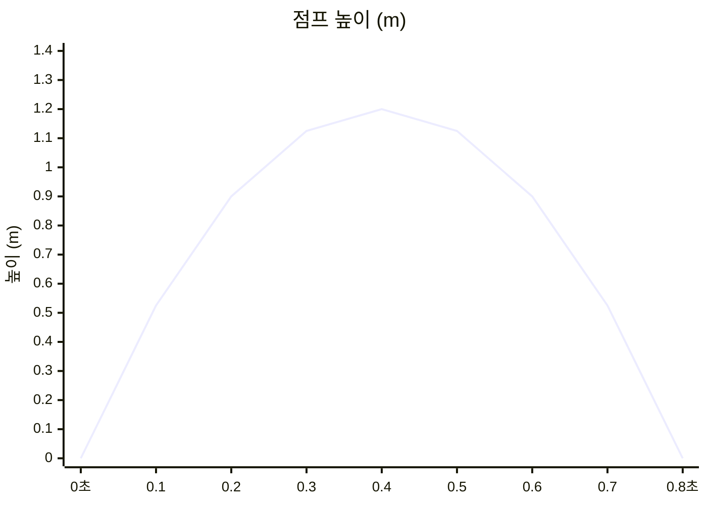
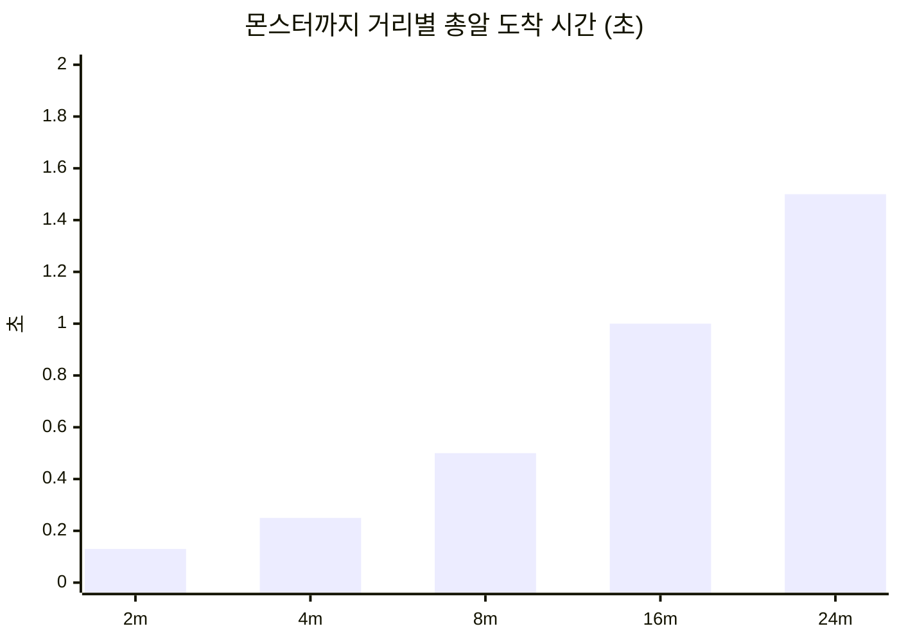

# 밸런스 · 데이터

> 문서 세트: [목차](common_Index.md) · 기획: [컨셉](planning_Concept.md) · [시스템](planning_System.md) · [전투·개체](planning_Combat_Entity.md) · [레벨 디자인](planning_LevelDesign.md) · **밸런스** · 사업·운영: [사업 검토](owner_Business.md) · [요구사항·로드맵](planning_Requirements.md) · [Business Model](planning_Monetization.md) · [서버·데이터](dev_Server_Data.md) · [리소스](design_Resources.md) · [로그·지표](planning_Analytics.md) · [QA·출시](qa_QA_Release.md) · [라이브 운영](ops_LiveOps.md) · [사업화·법무](owner_Business_Legal.md) · [needFix](common_needFix.md)
> 데이터 파일 (JSON · Unity `JsonUtility`로 바로 읽는 구조): [`player.json`](planning_Balance/player.json) · [`enemy.json`](planning_Balance/enemy.json)
> 값은 `mmain` 씬 · 프리팹에 저장된 실제 값 기준

> **문서 정보** · 문서 번호 `D06-BAL` · 버전 v1.0 · 상태 `Review` · 담당 밸런스 기획자 · 최종 수정 2026-11-21 · 관련 문서 [밸런스 JSON](planning_Balance) · [Business Model](planning_Monetization.md)

**변경 이력**

| 버전 | 날짜 | 변경 내용 | 사유 | 결정자 | 영향 범위 |
|---|---|---|---|---|---|
| v0.9 | 2026-11-20 | 기존 문서 (자세한 기록은 git 커밋) | — | 밸런스 기획자 | — |
| v1.0 | 2026-11-21 | 문서 정보 · 변경 이력 · 문서 번호 추가, 사업 · 운영 문서와 연결 | — | 밸런스 기획자 | 문서만 |

---

## 1. 플레이어 (`player.json`)
| 이동 | 점프 힘 | 중력 | 체공 시간 | 최고 높이 | 여유 거리 | 턱 높이 |
|---|---|---|---|---|---|---|
| 5 m/s | 6 | 15 | **0.8초** | **1.2m** | 0.05 | 0.3 |

```
체공 시간 = 2 × 점프 힘 ÷ 중력 = 2 × 6 ÷ 15 = 0.8초
최고 높이 = 점프 힘² ÷ (2 × 중력) = 36 ÷ 30 = 1.2m
```

**[선그래프] 점프 높이 (위 속도 6 · 중력 15)**


## 2. 몬스터 · 총알 (`enemy.json`)
| 수 | 발사 간격 | 평균 간격 | 1마리 초당 | 전체 초당 | 총알 속도 | 수명 | 사거리 |
|---|---|---|---|---|---|---|---|
| 4 | 0.5 ~ 3초 | 1.75초 | 0.57발 | **2.29발** | 16 | 3초 | **48m** |

```
평균 간격   = (0.5 + 3) ÷ 2 = 1.75초        (균등 랜덤의 기대값)
전체 초당   = 4마리 ÷ 1.75초 = 2.29발
사거리      = 16 m/s × 3초 = 48m
```

## 3. 속도 관계
```
player  5 m/s  ----->
bullet 16 m/s  ---------------->     총알이 3.2배 빠름: 달려서 도망칠 수 없음
                                     -> 총알 진행 방향의 옆으로 비키거나 엄폐물 뒤로
```
| 비교 | 값 |
|---|---|
| 총알 속도 ÷ 플레이어 속도 | 16 ÷ 5 = 3.2 |
| 몬스터까지 거리 d일 때 총알 도착 시간 | d ÷ 16 초 (예: 8m → 0.5초) |
| 0.5초 동안 플레이어가 움직이는 거리 | 5 × 0.5 = 2.5m |

**[막대그래프] 몬스터까지 거리별 총알 도착 시간 (초)**


