# 시스템 — 이동 · 회피 · 게임 흐름

> 문서 세트: [목차](common_Index.md) · 기획: [컨셉](planning_Concept.md) · **시스템** · [전투·개체](planning_Combat_Entity.md) · [레벨 디자인](planning_LevelDesign.md) · [밸런스](planning_Balance.md) · 사업·운영: [사업 검토](owner_Business.md) · [요구사항·로드맵](planning_Requirements.md) · [Business Model](planning_Monetization.md) · [서버·데이터](dev_Server_Data.md) · [리소스](design_Resources.md) · [로그·지표](planning_Analytics.md) · [QA·출시](qa_QA_Release.md) · [라이브 운영](ops_LiveOps.md) · [사업화·법무](owner_Business_Legal.md) · [needFix](common_needFix.md)
> 관련 코드: `PlayerInput.cs` · `BulletSpawner.cs` · `Bullet.cs` · `GameManager.cs` · `SceneChange.cs` · `Rotator.cs` · `Editor/Graze*.cs`

> **문서 정보** · 문서 번호 `D03-SYSTEM` · 버전 v1.0 · 상태 `Review` · 담당 기획자 · 클라이언트 개발자 · 최종 수정 2026-11-21 · 관련 문서 [전투·개체](planning_Combat_Entity.md) · [Business Model](planning_Monetization.md)

**변경 이력**

| 버전 | 날짜 | 변경 내용 | 사유 | 결정자 | 영향 범위 |
|---|---|---|---|---|---|
| v0.9 | 2026-11-20 | 기존 문서 (자세한 기록은 git 커밋) | — | 기획자 | — |
| v1.0 | 2026-11-21 | 문서 정보 · 변경 이력 · 문서 번호 추가, 사업 · 운영 문서와 연결 | — | 기획자 | 문서만 |

---

## 0. 한눈에 보는 시스템 구조

**[구성도] 스크립트 연결**
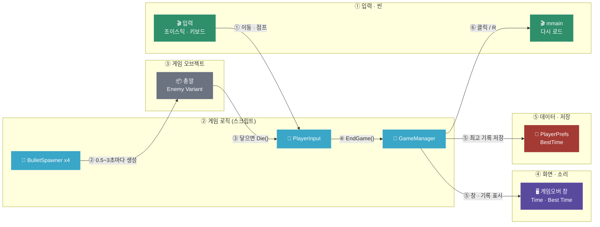

## 1. 화면 흐름
빌드 씬: `0 Intro` → `1 mmain`

**[상태도] 화면 전환**
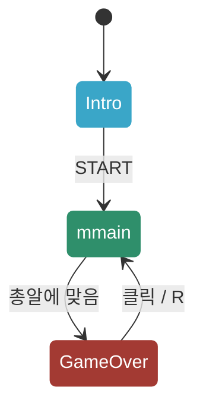

**[와이어프레임] 플레이 화면 (기준 1920 × 1080)**
```
+----------------------------------------------------------------+
|---------------------------------                               |
|:                               :                               |
|:                               :                               |
|:                          -----:-------------------            |
|:                          -----:------C------------            |
|:                               :                               |
|:                               :                               |
|:                               :                               |
|:                               :                               |
|:               A               :                               |
|:                               :               ------          |
|:                               :               :    :          |
|:                               :               :  B :          |
|:                               :               :    :          |
|:                               :               ------          |
|:                               :                               |
|:                               :                               |
|---------------------------------                               |
+----------------------------------------------------------------+
```

| 표시 | 요소 | 하는 일 | 씬 이름 · 화면 위치 (x, y 픽셀, 왼쪽 아래 = 0) |
|---|---|---|---|
| A | 조이스틱 영역 | 왼쪽 절반 어디든 눌러 이동 | `Dynamic Joystick` · 0 ~ 960, 0 ~ 1080 |
| B | 점프 버튼 | 1단 점프 | `JumpButton` · 1432.7 ~ 1605, 222 ~ 482 |
| C | 생존 시간 | 버틴 시간 표시 | `TimeText` · 834 ~ 1534, 772 ~ 872 |

**[와이어프레임] 게임오버 화면 (기준 1920 × 1080)**
```
+----------------------------------------------------------------+
|                                                                |
|                                                                |
|                                                                |
|                                                                |
|        ------------------------------------------------        |
|        :                                              :        |
|        :                       A                      :        |
|        :                                              :        |
|        ------------------------------------------------        |
|        ------------------------B-----------------------        |
|       ------------------------------------------------         |
|       ------------------------C-----------------------         |
|                                                                |
|                                                                |
|                                                                |
|                                                                |
|                                                                |
|                                                                |
+----------------------------------------------------------------+
```

| 표시 | 요소 | 하는 일 | 씬 이름 · 화면 위치 (x, y 픽셀, 왼쪽 아래 = 0) |
|---|---|---|---|
| A | 게임오버 글자 | 게임오버 표시 | `GameoverText` · 260 ~ 1660, 580 ~ 780 |
| B | 기록 | "Best Time: n" 표시 | `RecordText` · 260 ~ 1660, 490 ~ 590 |
| C | 재시작 안내 | 아무 곳이나 누르면 다시 시작 ([S-04](common_needFix.md)) | `RestartText` · 238 ~ 1638, 380 ~ 460 |

## 2. 상태 머신

**[상태도] 게임 (`GameManager`)**
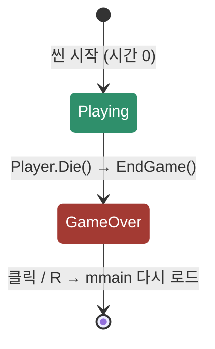

**[상태도] 플레이어 (`PlayerInput`)**
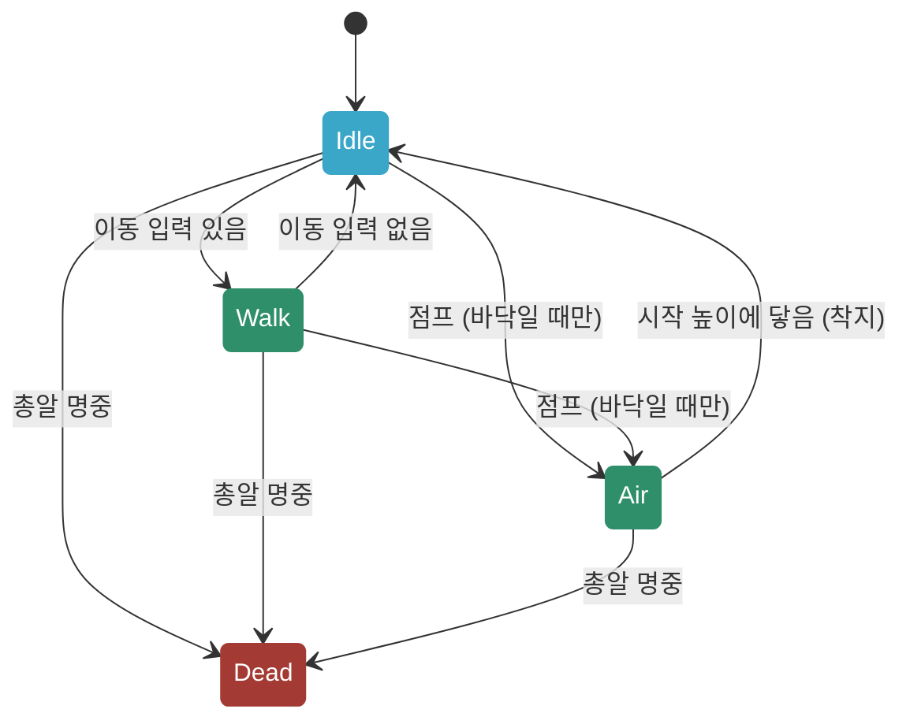

| 상태 | 애니메이션 | 발소리 | 이동 |
|---|---|---|---|
| Idle | `Walk` false | 끔 | – |
| Walk | `Walk` true | 루프 재생 | 5 m/s |
| Air | `Jump` 트리거 | 끔 | 공중에서도 이동 가능 |
| Dead | – (오브젝트 꺼짐) | – | – |

## 3. 작동 로직
### 3-1. 이동 + 벽 막힘

**[흐름도] 이동 (매 프레임)**
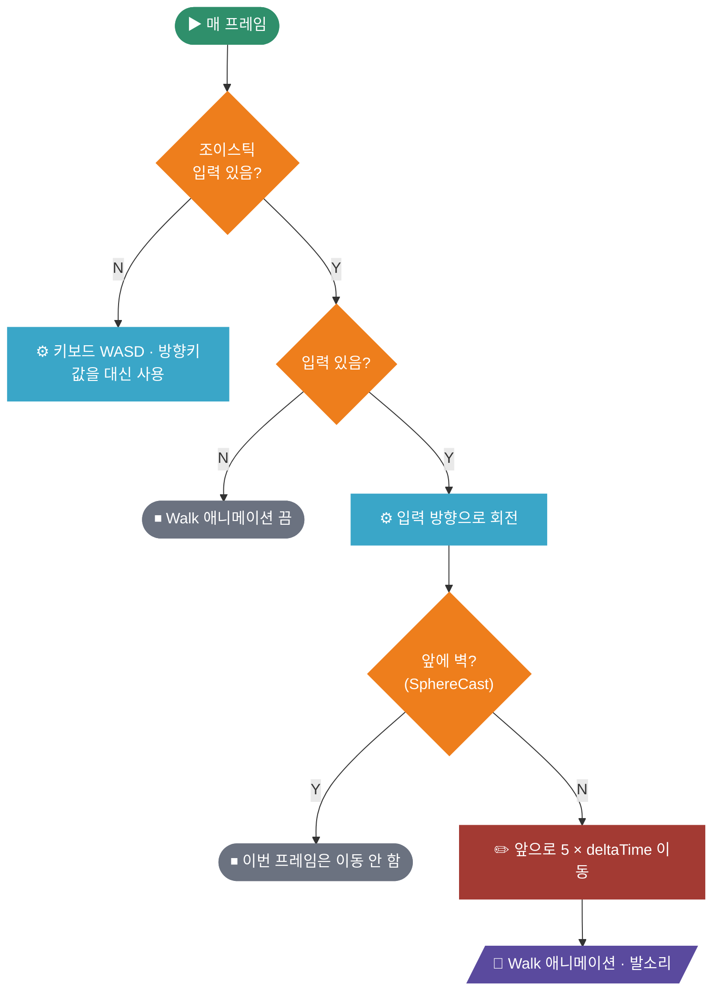

```
(옆에서 본 모습)
                       ####
   P    (o) ------->   ####      (o) = 검사용 구: 몸 너비의 80%, 앞으로 쏨
   |                   ####      닿으면 이번 프레임 이동 취소
   |                   ####
 --+-------__----------####---   __ = 0.3m 이하 턱 · 바닥 -> 벽으로 안 봄
   ^
   +-- 발밑에서 0.3m(stepHeight) 띄운 높이에서 검사
```

> 세부 조건(코드 기준)은 [부록 A-1](#a-1-이동--벽-막힘)에 있어요.

### 3-2. 점프 (물리 엔진 대신 직접 계산한 중력)

**[흐름도] 점프**
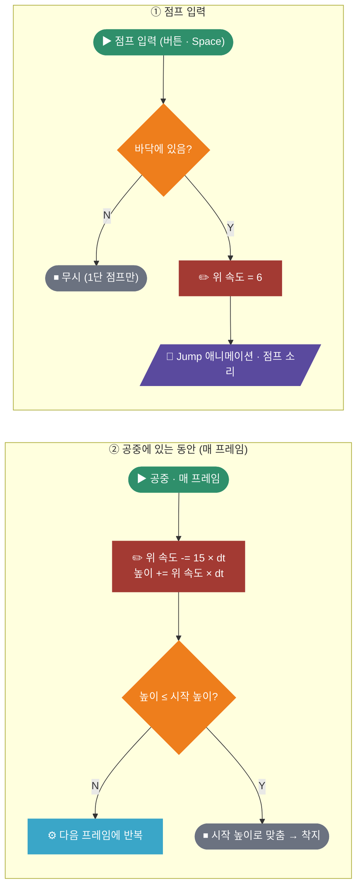

**[선그래프] 점프 높이 (0.1초 간격)**
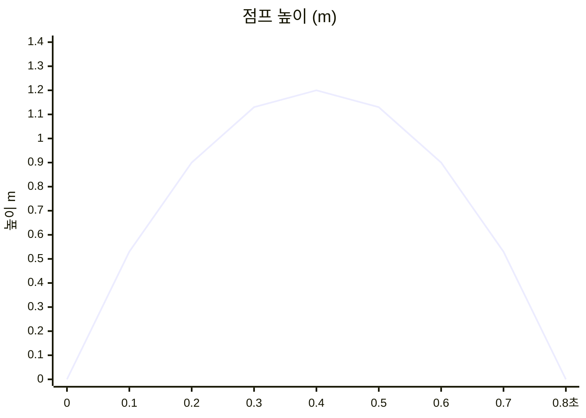

> 세부 조건(코드 기준)은 [부록 A-2](#a-2-점프-물리-엔진-대신-직접-계산한-중력)에 있어요.

### 3-3. 몬스터 발사

**[흐름도] 몬스터 1마리 발사 (4마리가 각자)**
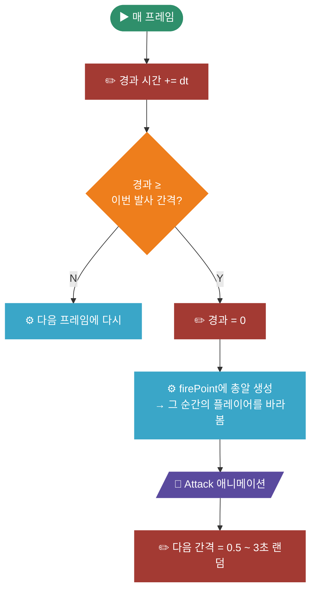

> 세부 조건(코드 기준)은 [부록 A-3](#a-3-몬스터-발사)에 있어요.

### 3-4. 총알

**[흐름도] 총알 하나**
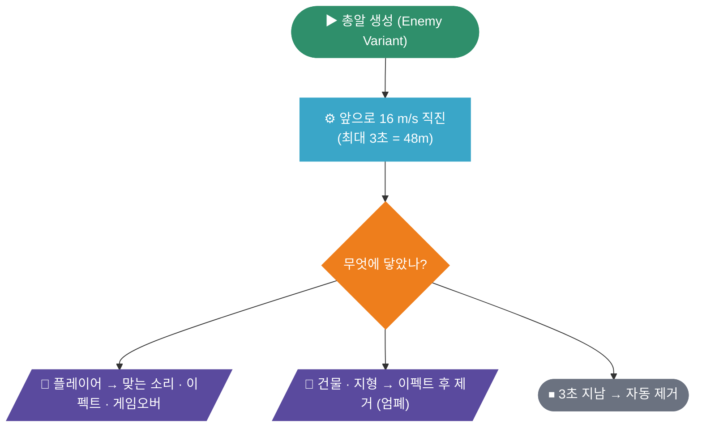

> 세부 조건(코드 기준)은 [부록 A-4](#a-4-총알)에 있어요.

### 3-5. 게임오버 · 기록

**[흐름도] 맞은 순간부터 다시 시작까지**
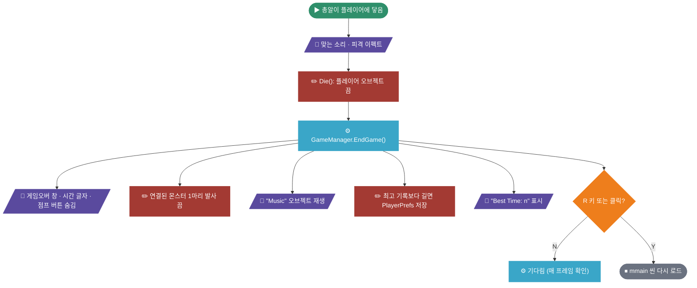

> 세부 조건(코드 기준)은 [부록 A-5](#a-5-게임오버--기록)에 있어요.

## 4. 예외 처리 (Edge Case) — 현재 동작
**[구성도] 예외 처리 지도**
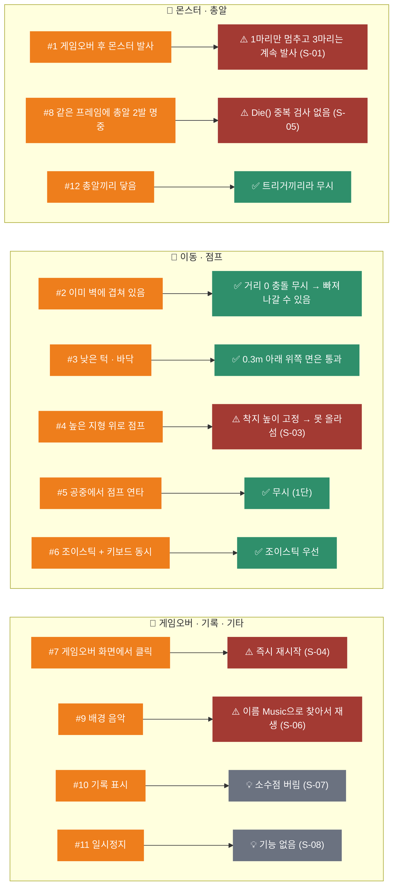

| # | 상황 | 현재 동작 | 상태 |
|---|---|---|---|
| 1 | 게임오버 후 몬스터 발사 | 연결된 1마리만 멈추고 나머지 3마리는 계속 발사 | ⚠️ → [S-01](common_needFix.md) |
| 2 | 벽 판정 중 이미 벽에 겹쳐 있음 | 거리 0인 충돌 무시 → 빠져나갈 수 있음 | ✅ |
| 3 | 낮은 턱 · 바닥 | 0.3m 아래 위쪽 면은 통과 | ✅ |
| 4 | 높은 지형 위로 점프 | 착지 높이가 "시작 높이"로 고정 → 위에 올라설 수 없음 | ⚠️ → [S-03](common_needFix.md) |
| 5 | 공중에서 점프 연타 | 무시 (1단) | ✅ |
| 6 | 조이스틱과 키보드 동시 입력 | 조이스틱 우선 | ✅ |
| 7 | 게임오버 화면에서 클릭 | 즉시 재시작 | ⚠️ → [S-04](common_needFix.md) |
| 8 | 같은 프레임에 총알 2발 명중 | `Die()`를 막는 검사 없음 | ⚠️ → [S-05](common_needFix.md) |
| 9 | 배경 음악 | 이름("Music")으로 찾아서 재생 | ⚠️ → [S-06](common_needFix.md) |
| 10 | 기록 표시 | 소수점 버림(정수) | → [S-07](common_needFix.md) |
| 11 | 일시정지 | 기능 없음 | → [S-08](common_needFix.md) |
| 12 | 총알끼리 닿음 | 트리거끼리라 무시 | ✅ |

## 5. 에디터 자동화 도구
| 도구 | 하는 일 |
|---|---|
| `GrazeIntroSetup` | Intro 씬(배경 · 제목 · START 버튼) 자동 생성 |
| `GrazeMapColliders` | 움직이지 않는 오브젝트의 콜라이더를 Mesh Collider로 일괄 변환 |
| `GrazeSoundSetup` | 플레이어 AudioSource 자동 연결 |

---

## 부록 A. 세부 조건 (코드 기준)
본문 흐름도의 조건을 코드 그대로 적은 개발 참고용이에요. 기획 내용은 본문에 있어요.

### A-1. 이동 + 벽 막힘
```
매 프레임
├─ 입력 = 조이스틱 (가로, 세로)
├─ IF 조이스틱 입력 없음 → 키보드 방향키 / WASD 값 사용
├─ IF 입력 있음
│   ├─ 입력 방향을 바라보게 회전
│   ├─ 이번 프레임 이동 거리 = 5 × deltaTime
│   ├─ 벽 검사 IsBlocked(앞, 거리)
│   │   ├─ 발밑에서 0.3m(stepHeight) 띄운 구를 앞으로 SphereCastAll
│   │   ├─ 맞은 것 중 무시: 내 몸 / 이미 겹친 것 / 위를 향한 면이면서 발밑 0.3m 아래인 것(바닥 · 낮은 턱)
│   │   └─ 그 밖의 것이 하나라도 있으면 → 벽 (true)
│   ├─ IF 벽 아님 → 앞으로 이동
│   └─ Walk 애니메이션 켬
└─ ELSE → Walk 애니메이션 끔
발소리: 이동 중 AND 바닥 → 재생 / 그 외 → 정지
```

### A-2. 점프 (물리 엔진 대신 직접 계산한 중력)
```
점프 입력 (버튼 / Space)
├─ IF 공중 → 무시 (1단 점프만)
└─ ELSE → 위 속도 = 6, Jump 애니메이션, 점프 소리

공중일 때 매 프레임
├─ 위 속도 -= 15 × deltaTime
├─ 높이 += 위 속도 × deltaTime
└─ IF 높이 ≤ 시작 높이 → 시작 높이로 맞추고 착지
```

### A-3. 몬스터 발사
```
몬스터마다 매 프레임
├─ 경과 시간 += deltaTime
└─ IF 경과 ≥ 이번 발사 간격
    ├─ 경과 0으로
    ├─ 발사 지점(firePoint)에 총알(`Enemy Variant` 프리팹) 생성 → 플레이어를 바라보게 (LookAt)
    ├─ 공격 애니메이션 (발사와 같은 순간)
    └─ 다음 발사 간격 = 0.5 ~ 3초 랜덤
```

### A-4. 총알
```
생성 → 앞으로 속도 16 → 3초 뒤 자동 제거
트리거 충돌
├─ IF 대상 태그 = "PlayerInput"
│   ├─ 맞는 소리 · 이펙트
│   └─ Player.Die() → 플레이어 끔 → GameManager.EndGame() → "Music" 오브젝트 재생
└─ ELSE IF 트리거가 아닌 물체 AND 몬스터 자신이 아님 → 이펙트 후 총알 제거
```

### A-5. 게임오버 · 기록
```
EndGame()
├─ isGameover = true, 게임오버 창 켬, 시간 글자 · 점프 버튼 숨김
├─ GameManager에 연결된 몬스터 1마리: 발사 끔 + 대기 애니메이션(IdleNormal)
├─ 최고 기록 = PlayerPrefs("BestTime")
├─ IF 이번 시간 > 최고 기록 → 저장
└─ "Best Time: (정수)" 표시
게임오버 중 매 프레임: IF R키 OR 마우스 클릭 → mmain 다시 로드
```
